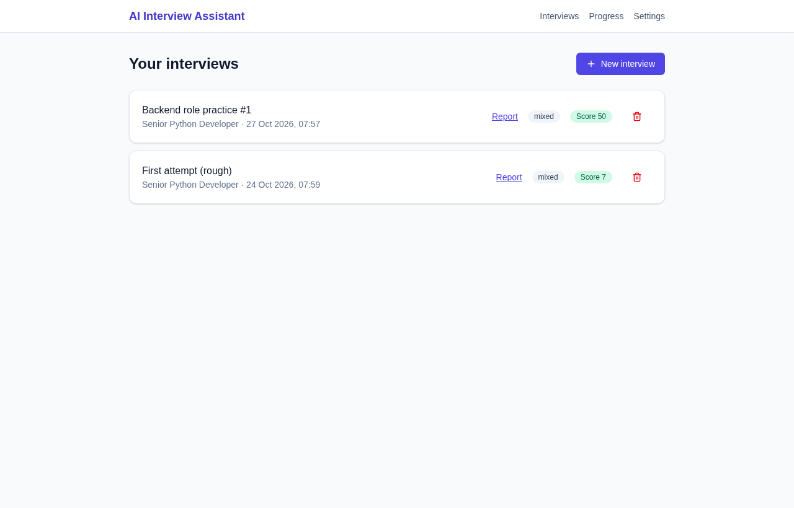
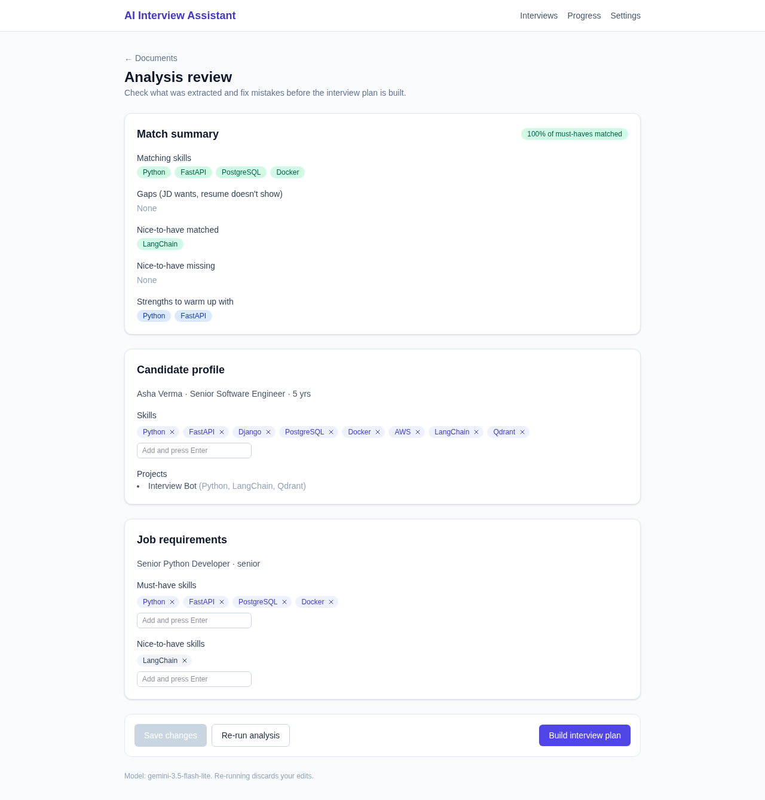
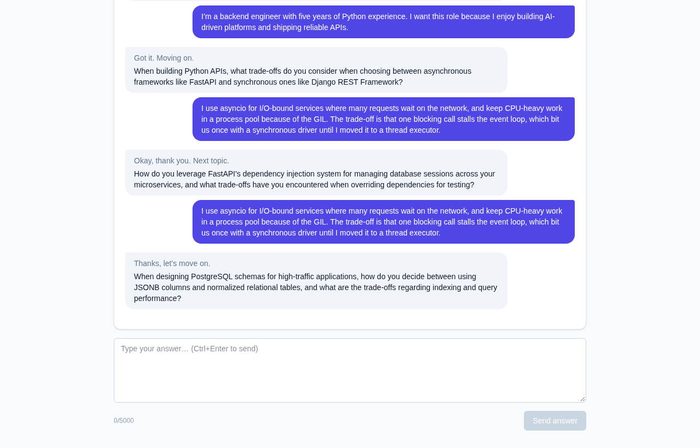
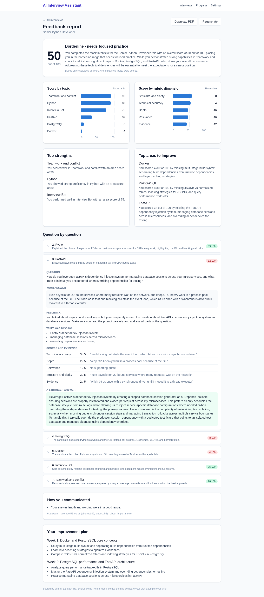

# AI Interview Assistant

An open-source web app for interview practice. Upload your resume and a job description. The app analyses both, runs a mock interview tailored to you and that role, and then gives you a scored feedback report with a study plan.

You choose where the AI runs:

- **Local (free and private):** open-source models through [Ollama](https://ollama.com). Your resume never leaves your computer. Slow on a laptop without a GPU.
- **Google Gemini (cloud, fast):** bring your own API key. A free key works. Your resume and job description are sent to Google.

Everything else is open source and free: FastAPI, React, SQLite and Qdrant.

| Home | Analysis review |
|---|---|
|  |  |
| **Live interview** | **Feedback report** |
|  |  |

Watch a 100-second walkthrough from upload to report: [docs/demo.mp4](docs/demo.mp4). More screenshots are in [docs/screenshots/](docs/screenshots/).

## What it does

1. **Create an interview:** target role, type (technical, behavioural or mixed), difficulty and number of questions.
2. **Upload documents:** resume (PDF, DOCX or TXT), job description (file or pasted text) and optional extras. Each file shows Uploaded, Parsing, then Ready, and you can read the extracted text.
3. **Analysis:** the model extracts your profile and the job's requirements. You review and correct them (add or remove skills) before anything else happens. A gap analysis shows matching skills, gaps and claims the interviewer will probe.
4. **Plan:** a topic outline (introduction, core skills, project deep dives, gap areas, behavioural, your questions). The questions stay hidden so the interview feels real.
5. **Live interview:** a chat room with streamed questions and adaptive follow-ups. The interviewer never shows scores or hints. If you reload the page you pick up where you left off.
6. **Feedback report (only when you ask for it):** every answer is scored 1 to 5 on accuracy, depth, relevance, structure and evidence, each with a quote from your answer. You get an overall score and verdict, scores by topic and dimension, strengths and improvement areas, a per-question breakdown with a stronger sample answer, communication notes and a two-week study plan. Download it as a PDF.
7. **Progress:** compare two attempts side by side to see what improved.
8. **Privacy controls:** delete one interview, or everything, from the app.

## Quick start with Docker

You need Docker. Then:

```bash
git clone https://github.com/kailash2488/ai-interview-assistant.git
cd ai-interview-assistant
docker compose up --build
```

Open http://localhost:8080 and go to **Settings** to pick a model:

- **Gemini (easiest):** choose Gemini, paste a key from [Google AI Studio](https://aistudio.google.com/apikey), save, and press Test connection.
- **Local model with Ollama on this computer:** install Ollama and run `ollama pull mistral:7b` and `ollama pull nomic-embed-text`. Docker containers cannot reach an Ollama that listens only on `127.0.0.1` (the default). Either make it listen on all interfaces (for example `OLLAMA_HOST=0.0.0.0`, which also exposes it to your network) or use the next option.
- **Local model with Ollama inside Docker:**
  ```bash
  OLLAMA_URL=http://ollama:11434 docker compose --profile local-llm up --build
  docker compose exec ollama ollama pull mistral:7b
  docker compose exec ollama ollama pull nomic-embed-text
  ```
  (This path is configured but has not been tested end to end.)

Change the port with `APP_PORT=9000 docker compose up`. Your data lives in Docker volumes; `docker compose down -v` removes it.

## Run without Docker

Needs Python 3.10 or later and Node 20 or later.

```bash
# backend (terminal 1)
cd backend
python -m venv ../env && source ../env/bin/activate
pip install -e ".[dev]"
uvicorn app.main:app --reload          # API docs at http://localhost:8000/docs

# frontend (terminal 2)
cd frontend
npm install
npm run dev                            # http://localhost:5173, proxies /api to port 8000
```

`frontend/.npmrc` sets `legacy-peer-deps=true`, which works around a peer-dependency crash in npm 10.

## Choosing a model

| | Local (Ollama) | Gemini |
|---|---|---|
| Cost | Free | Free tier with rate limits, or paid |
| Privacy | Stays on your computer | Sent to Google; the free tier may be used to improve Google's products |
| Speed on a CPU-only laptop | Analysis about 2 minutes, each interview turn 10 to 60 seconds | Analysis about 5 seconds, each turn 2 to 4 seconds |
| Setup | Install Ollama, pull two models | Paste a key |

Local benchmark on 8 sample documents (see [docs/benchmarks/](docs/benchmarks/)): `mistral:7b` gave 100% valid JSON and 88% skill recall in about 43 s per document; `qwen2.5:7b` gave 100% and 91% in about 60 s. `mistral:7b` is the default.

Gemini models offered in Settings: `gemini-3.5-flash-lite` (recommended), `gemini-3.8-flash`, `gemini-3.6-flash` and `gemini-3.1-pro-preview`. During testing `gemini-3.8-flash` was often overloaded on the free tier, so Flash-Lite is the default. Check your own limits in AI Studio. Free-tier limits are per minute, so a long report may pause and retry.

Check your setup from a terminal with `python backend/scripts/check_llm.py`.

## Configuration

Settings come from environment variables prefixed `AIA_`, or a `backend/.env` file (see `backend/.env.example`). The Settings page overrides the provider, model and key and saves them to `backend/data/llm_settings.json` (readable only by you, git-ignored). The key is never sent back to the browser.

| Variable | Default | Meaning |
|---|---|---|
| `AIA_LLM_PROVIDER` | `ollama` | `ollama` or `gemini` |
| `AIA_GEMINI_API_KEY` | none | Gemini key (or set it on the Settings page) |
| `AIA_GEMINI_MODEL` | `gemini-3.5-flash-lite` | Gemini model |
| `AIA_OLLAMA_URL` | `http://localhost:11434` | Where Ollama runs |
| `AIA_INTERVIEWER_MODEL`, `AIA_EVALUATOR_MODEL` | `mistral:7b` | Ollama chat models |
| `AIA_EMBED_MODEL` | `nomic-embed-text` | Ollama embedding model |
| `AIA_MAX_UPLOAD_MB` | `10` | Upload size limit |
| `AIA_MAX_OTHER_DOCUMENTS` | `10` | Extra documents per interview |

## How it works

```
React (Vite)  --REST + WebSocket-->  FastAPI
                                       |- ingestion   parse -> clean -> section -> embed
                                       |- analysis    profile, requirements, gap analysis (gap in plain code)
                                       |- interview   plan (plain code) + state machine + interviewer
                                       |- feedback    rubric evaluator, guards, report, PDF
                                       |- llm         Ollama or Gemini client, JSON-schema output, retry
                                       +- SQLite + embedded Qdrant
```

Design rules:

- **The code decides, the model writes.** The interview plan, follow-up limits, scores, verdict and gap analysis are plain code. The model only writes question wording, judges individual answers and writes the report text.
- **Structured outputs everywhere.** Model replies are validated against Pydantic schemas, retried once, and fall back safely (for example to a planned question).
- **Small models first.** Short prompts, one task per call, a worked example in each prompt. Prompts live in [backend/app/prompts/](backend/app/prompts/).
- **Honest scoring.** A score above 3 needs a quote that really appears in the answer. Very short answers cannot score high on depth or evidence. Strengths only come from topics that scored well. `python backend/scripts/calibrate.py` checks that the evaluator ranks hand-labelled strong, average and weak answers correctly (with `gemini-3.5-flash-lite`: strong 94 to 100, average 44 to 61, weak 7 to 26).
- **Uploaded text is data.** Resume, job description and answers are delimited in prompts and the model is told never to follow instructions inside them.

## Tests

```bash
cd backend && pytest                  # 180+ tests; add --cov=app for coverage (about 96%)
cd frontend && npm test               # 54 tests
```

The model is replaced by a fake in tests, so they need no network or API key.

## Project layout

```
backend/app/api         routers (sessions, documents, analysis, interview, report, history, settings, data)
backend/app/services    ingestion, analysis, interview, feedback, llm, vectorstore
backend/app/prompts     versioned prompt templates
backend/scripts         benchmark.py, calibrate.py, check_llm.py
frontend/src            pages, components, API client
data/samples            sample resumes, job descriptions, calibration answers
docs                    SOP.pdf (the original plan), benchmarks, screenshots
```

## Limitations

- Local models on a CPU-only laptop are slow. Use Gemini or a machine with a GPU for a smooth experience.
- Scores come from a rubric applied by a language model, so they are good for comparing your own attempts over time and for spotting weak areas. They are not a hiring decision.
- Text only, English only, one user. There are no accounts or login by design.
- Scanned PDFs are not supported (no OCR).
- Long jobs run as background tasks inside the API process. If you restart the backend during an analysis or report, start it again from the app.

## Roadmap

Voice mode (local speech-to-text and text-to-speech), a progress dashboard over many sessions, coding and system-design rounds. See [docs/SOP.pdf](docs/SOP.pdf).

## Licence

MIT
