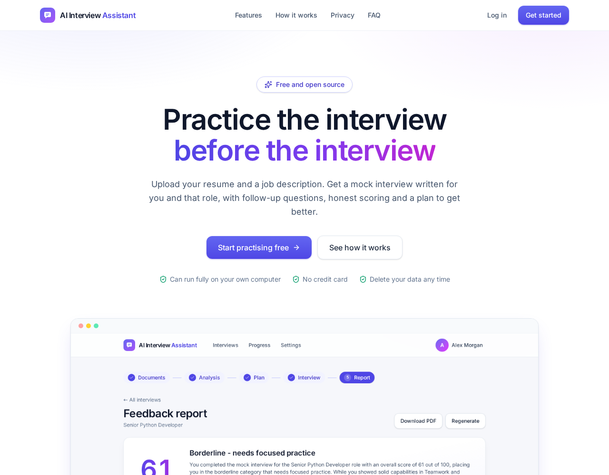
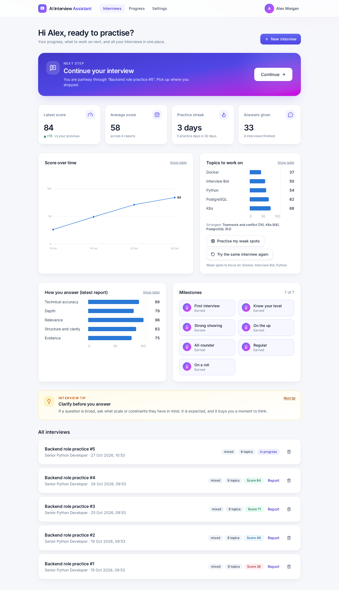
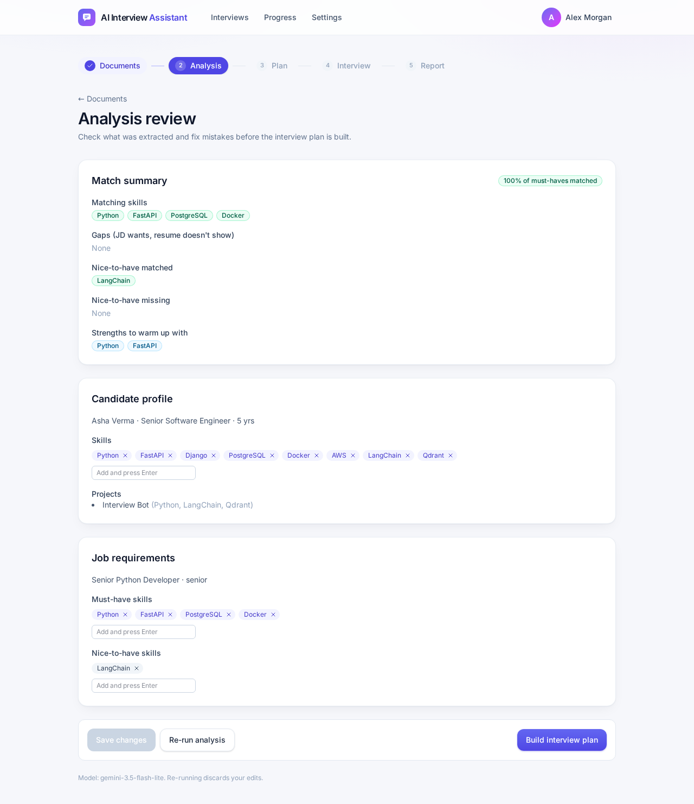
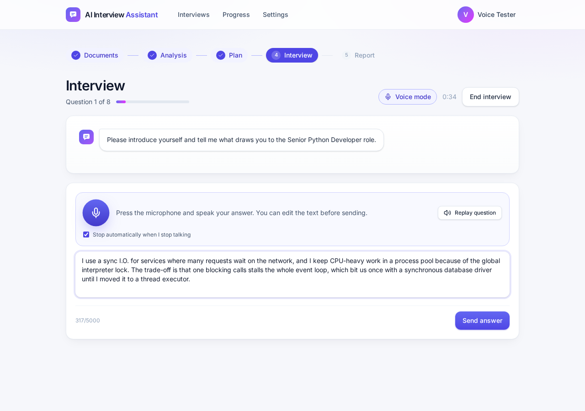
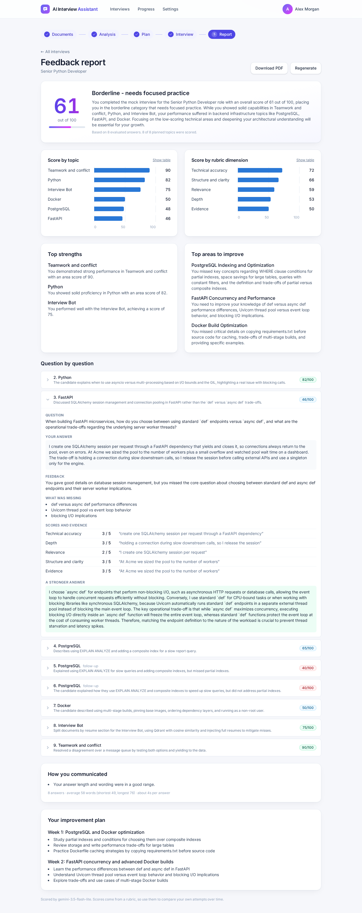
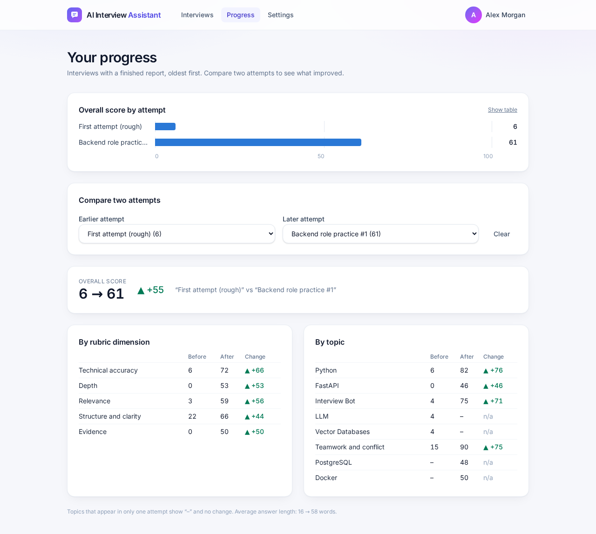

# AI Interview Assistant

An open-source web app for interview practice. Create an account, upload your resume and a job description, and the app runs a mock interview written for you and that role, then gives you a scored feedback report with a study plan.

You choose where the AI runs, per account:

- **Local (free and private):** open-source models through [Ollama](https://ollama.com). Your resume never leaves your computer. Slow on a laptop without a GPU.
- **Google Gemini (cloud, fast):** bring your own API key. A free key works. Your resume and job description are sent to Google.
- **OpenAI or Anthropic:** use your own API key and model ID for GPT or Claude models.
- **Azure OpenAI:** connect an enterprise Azure resource with its endpoint, deployment name, API version and key.

Everything else is open source and free: FastAPI, React, SQLite and Qdrant.

| Landing page | Dashboard |
|---|---|
|  |  |
| **Analysis review** | **Interview by voice** |
|  |  |
| **Feedback report** | **Progress across attempts** |
|  |  |

Watch a walkthrough from sign-up to report: [docs/demo.mp4](docs/demo.mp4) (recorded with an earlier version of the interface, before the dashboard and voice mode). More screenshots (sign-up, settings, mobile, practising weak spots) are in [docs/screenshots/](docs/screenshots/).

## Contents

1. [What it does](#what-it-does)
2. [What you need](#what-you-need)
3. [Run it with Docker (quickest)](#run-it-with-docker-quickest)
4. [Run it from source: backend and frontend, step by step](#run-it-from-source-backend-and-frontend-step-by-step)
5. [Set up the AI model](#set-up-the-ai-model)
6. [Take your first interview](#take-your-first-interview)
7. [Voice mode](#voice-mode)
8. [Accounts and security](#accounts-and-security)
9. [Configuration reference](#configuration-reference)
10. [Tests and developer tools](#tests-and-developer-tools)
11. [Where your data lives, backups and reset](#where-your-data-lives-backups-and-reset)
12. [Troubleshooting](#troubleshooting)
13. [How it works](#how-it-works)
14. [Project layout, limitations and roadmap](#project-layout-limitations-and-roadmap)

## What it does

1. **Sign up or log in.** Visitors see a landing page that explains the app. Each account has its own interviews, reports and model settings. Once signed in, the dashboard shows your suggested next step, latest and average score, practice streak, a score trend, the topics you should work on, how you score on each part of the rubric, milestones you have earned, and an interview tip.
2. **Create an interview:** target role, type (technical, behavioural or mixed), difficulty and number of topics.
3. **Upload documents:** resume (PDF, DOCX or TXT), job description (file or pasted text) and optional extras. Each file shows Uploaded, Parsing, then Ready, and you can read the extracted text.
4. **Analysis:** the model extracts your profile and the job's requirements. You review and correct them (add or remove skills) before anything else happens. A gap analysis shows matching skills, gaps and claims the interviewer will probe.
5. **Plan:** a topic outline (introduction, core skills, project deep dives, gap areas, behavioural, your questions). The questions stay hidden so the interview feels real.
6. **Live interview:** a chat with streamed questions and adaptive follow-ups. The interviewer never shows scores or hints. If you reload the page you pick up where you left off. Switch on **voice mode** to hear each question and answer by speaking (see [Voice mode](#voice-mode)).
7. **Feedback report (only when you ask for it):** every answer is scored 1 to 5 on accuracy, depth, relevance, structure and evidence, each with a quote from your answer. You get an overall score and verdict, scores by topic and dimension, strengths and improvement areas, a per-question breakdown with a stronger sample answer, communication notes and a two-week study plan. Download it as a PDF.
8. **Practise again:** start a new interview from the same documents without uploading or analysing anything twice, either the same interview again or one that asks your weakest topics first.
9. **Progress:** compare two attempts side by side to see what improved.
10. **Privacy controls:** delete one interview, all your data, or your whole account from the app.

## What you need

| You need | For | Check it with | Notes |
|---|---|---|---|
| **Git** | getting the code | `git --version` | any recent version |
| **Python 3.10 or newer** | the backend (from source) | `python3 --version` | 3.10, 3.11 and 3.12 work. The Docker image uses 3.11. |
| **Node.js 20 or newer** (with npm) | the frontend (from source) | `node --version` and `npm --version` | install from [nodejs.org](https://nodejs.org) or `nvm` |
| **Docker with Compose v2** | the Docker route only | `docker --version` and `docker compose version` | Compose 2.24 or newer, because the optional `backend/.env` is loaded with `required: false` |
| **An AI model**: Ollama or a supported cloud-provider key | analysis, interview, report | see [Set up the AI model](#set-up-the-ai-model) | Ollama needs about 8 GB of free RAM for a 7B model. |
| **Microphone and a modern browser** | voice mode only (optional) | | Chrome, Edge, Firefox or Safari. The page must be on `localhost` or HTTPS. |

Disk space: about 1 GB for the Python packages, about 300 MB for the frontend packages, 4.4 GB for each Ollama chat model, about 200 MB for the voice models (optional).

Operating system: developed and tested on Linux (Ubuntu). macOS works the same way. On Windows use WSL2, or replace the virtual-environment activation line with `..\env\Scripts\activate`.

## Run it with Docker (quickest)

You need Docker (see above). Nothing else has to be installed.

1. **Get the code**
   ```bash
   git clone https://github.com/kailash2488/ai-interview-assistant.git
   cd ai-interview-assistant
   ```
2. **(Optional) give the server a Gemini key.** Skip this if you would rather paste the key on the Settings page later.
   ```bash
   cp backend/.env.example backend/.env
   ```
   Open `backend/.env`, remove the `#` in front of these three lines and put your own key in:
   ```
   AIA_LLM_PROVIDER=gemini
   AIA_GEMINI_API_KEY=your-key-here
   AIA_GEMINI_MODEL=gemini-3.5-flash-lite
   ```
   Compose passes this file to the backend. It is git-ignored: never commit it.
3. **Build and start everything**
   ```bash
   docker compose up --build
   ```
   The first build takes a few minutes. When you see the backend report healthy and the frontend start, it is ready. (Add `-d` to run it in the background.)
4. **Open http://localhost:8080** and click **Get started** to create your account. The first account is created by whoever gets there first, so do this straight away (see [Accounts and security](#accounts-and-security)).
5. **Pick your AI** on the Settings page if you did not set a server key (see [Set up the AI model](#set-up-the-ai-model)).
6. **Take your first interview** ([walkthrough](#take-your-first-interview)).

Everyday commands (run from the project folder):

| Do this | Command |
|---|---|
| Start in the background | `docker compose up -d` |
| See what is running | `docker compose ps` |
| Watch the backend log | `docker compose logs -f backend` |
| Stop (keeps your data) | `docker compose down` |
| Stop and delete all data | `docker compose down -v` |
| Rebuild after pulling new code | `git pull && docker compose up --build -d` |
| Use another port | `APP_PORT=9000 docker compose up -d` (then open http://localhost:9000) |
| Close registration | `ALLOW_SIGNUP=false docker compose up -d` |
| Serve over HTTPS (cookie flag) | `COOKIE_SECURE=true docker compose up -d` |

The Docker setup has three parts: `frontend` (nginx serving the built app and forwarding `/api`, including the interview WebSocket, to the backend), `backend` (the API) and an optional `ollama` service. Your data lives in Docker volumes named `ai_assistant_app-data` (database, encryption key, search index, voice models) and `ai_assistant_app-uploads` (uploaded files).

**Using Ollama (local models) with Docker.** Pick one:

- *Ollama already installed on this computer:* Docker containers cannot reach an Ollama that listens only on `127.0.0.1`, which is the default. Make it listen on all interfaces, for example `sudo systemctl edit ollama`, add `Environment="OLLAMA_HOST=0.0.0.0"`, then `sudo systemctl restart ollama`. This also exposes Ollama to your network, so only do it on a network you trust. The backend reaches it at `http://host.docker.internal:11434`.
- *Ollama inside Docker:*
  ```bash
  OLLAMA_URL=http://ollama:11434 docker compose --profile local-llm up --build -d
  docker compose exec ollama ollama pull mistral:7b
  docker compose exec ollama ollama pull nomic-embed-text
  ```
  (This path is configured but has not been tested end to end.)

**Voice mode with Docker.** The default image is lean. For voice, build with the speech libraries and download the models once:
```bash
INSTALL_VOICE=1 docker compose up --build -d
docker compose exec backend python scripts/download_voice.py     # about 200 MB, kept in the data volume
```
This was built and tested end to end, including speaking a question and transcribing an answer inside the container.

**If the Docker build is very slow or fails while downloading packages** (some machines have slow container networking), build on the host's network and then start without rebuilding:
```bash
docker build --network=host -t ai_assistant-backend:latest ./backend
docker compose up -d
```

## Run it from source: backend and frontend, step by step

You run two programs in two terminals: the **backend** (the API, port 8000) and the **frontend** (the web page, port 5173). The frontend forwards every request that starts with `/api` to the backend, so you only ever open the frontend's address.

### Step 1. Get the code

```bash
git clone https://github.com/kailash2488/ai-interview-assistant.git
cd ai-interview-assistant
```

### Step 2. Start the backend (terminal 1)

```bash
cd backend

# create a virtual environment in the project folder (named "env", which git ignores)
python3 -m venv ../env

# activate it. You will see (env) at the start of your prompt.
source ../env/bin/activate            # Windows: ..\env\Scripts\activate

# install the backend and its test tools (a few minutes the first time)
pip install -e ".[dev]"

# start the API
uvicorn app.main:app --reload
```

You should see `Uvicorn running on http://127.0.0.1:8000`. The first start also creates the folder `backend/data/` with the database `app.db`. Check it:

- http://localhost:8000/health returns `{"status":"ok"}`
- http://localhost:8000/docs shows the interactive API documentation

Leave this terminal open. To stop it, press `Ctrl+C`.

Optional, before you start: copy `backend/.env.example` to `backend/.env` and set a server-wide Gemini key (see [Set up the AI model](#set-up-the-ai-model)). Restart the backend after changing `.env`.

### Step 3. Start the frontend (terminal 2)

```bash
cd frontend
npm install        # a minute or two the first time
npm run dev
```

You should see `Local: http://localhost:5173/`. Leave this terminal open too.

The folder contains an `.npmrc` with `legacy-peer-deps=true`. Keep it: it works around a peer-dependency crash in npm 10 (`Cannot read properties of null (reading 'edgesOut')`).

### Step 4. Open the app and create your account

Go to **http://localhost:5173**. You will see the landing page. Click **Get started**, enter your name, email and a password of at least 8 characters, and you are signed in.

### Step 5. Choose the AI model

The backend needs a language model. Do [Set up the AI model](#set-up-the-ai-model) now (Gemini takes two minutes), then continue with [Take your first interview](#take-your-first-interview).

### Running it again later

Open two terminals and run:

```bash
# terminal 1
cd ai-interview-assistant/backend && source ../env/bin/activate && uvicorn app.main:app --reload

# terminal 2
cd ai-interview-assistant/frontend && npm run dev
```

After pulling new code: `git pull`, then in `backend/` run `pip install -e ".[dev]"` again and in `frontend/` run `npm install` again. Database changes (new columns) are applied automatically when the backend starts.

### Which address and port is what

| What | Address | Notes |
|---|---|---|
| The app (frontend, from source) | http://localhost:5173 | what you open in the browser |
| The API (backend, from source) | http://localhost:8000 | `/docs` for the API pages, `/health` for a quick check |
| The app (Docker) | http://localhost:8080 | change with `APP_PORT` |
| Ollama (if you use it) | http://localhost:11434 | `AIA_OLLAMA_URL` changes where the backend looks |

To use other ports: `uvicorn app.main:app --reload --port 8001` for the backend, then `VITE_BACKEND_URL=http://localhost:8001 npm run dev` for the frontend (add `-- --port 5174` to change its port).

### Build the frontend for production

```bash
cd frontend
npm run build        # type-checks, then writes the static site to frontend/dist
```
`frontend/dist` is plain static files. The Docker setup serves them with nginx and forwards `/api` to the backend (see `frontend/nginx.conf`, which shows the WebSocket headers any reverse proxy needs).

## Set up the AI model

Each account chooses its own provider on the **Settings** page. Credentials are encrypted per account and never returned to the browser. The server's settings only decide what an account uses until it chooses.

The Settings page supports five providers:

- **Ollama:** local and private; no key required.
- **Google Gemini:** paste a Google AI Studio key and choose a listed Gemini model.
- **OpenAI:** paste an OpenAI API key and enter a model ID such as `gpt-4o-mini`.
- **Anthropic:** paste an Anthropic API key and enter a Claude model ID such as `claude-3-5-haiku-latest`.
- **Azure OpenAI:** enter the Azure resource endpoint, deployment name, API version and API key.

Use **Test connection** after saving. Cloud providers receive resume, job-description and answer content needed for the selected task; review the provider's data-retention policy before using sensitive documents.

### Option A: Google Gemini (fastest, needs a key)

1. Go to https://aistudio.google.com/apikey and create an API key. A key from a free project uses the free tier.
2. In the app open **Settings**, choose **Google Gemini (cloud)**, paste the key, keep the model **Gemini 3.5 Flash-Lite** (recommended), click **Save**, then **Test connection**. You should see a green line with the model name and the time it took.
3. Or set it for the whole server instead, in `backend/.env`:
   ```
   AIA_LLM_PROVIDER=gemini
   AIA_GEMINI_API_KEY=your-key-here
   ```
   and restart the backend. Accounts that have not saved their own key will use this one.

Good to know: with Gemini your resume and job description are sent to Google, and on the free tier Google may use them to improve its products. Free-tier limits are per minute, so a long report may pause and retry. `gemini-3.8-flash` was often overloaded during testing; Flash-Lite is the safe default. Your key is stored encrypted and is never shown again, only its last four characters.

### Local option: Ollama (free and private, slower)

1. Install Ollama: `curl -fsSL https://ollama.com/install.sh | sh` (Linux; see https://ollama.com/download for macOS and Windows). It starts a background service on port 11434.
2. Download the two models (about 5 GB in total):
   ```bash
   ollama pull mistral:7b            # writes the questions and the feedback
   ollama pull nomic-embed-text      # lets the interviewer search your documents
   ```
3. Check it: `ollama list` shows both, and `curl http://localhost:11434/api/version` answers.
4. In the app open **Settings**, choose **Local model (free)**, click **Save**, then **Test connection**. The server default is already the local model, so a new account works without changing anything.

Expect a CPU-only laptop to take about two minutes for the analysis and 10 to 60 seconds per interview turn. Close other heavy programs while you practise. A smaller model such as `llama3.2:3b` is faster but writes weaker questions: set `AIA_INTERVIEWER_MODEL=llama3.2:3b` in `backend/.env`.

### How the two compare

| | Local (Ollama) | Gemini |
|---|---|---|
| Cost | Free | Free tier with rate limits, or paid |
| Privacy | Stays on your computer | Sent to Google |
| Speed on a CPU-only laptop | Analysis about 2 minutes, each turn 10 to 60 seconds | Analysis about 5 seconds, each turn 2 to 4 seconds |
| Setup | Install Ollama, pull two models | Paste a key |

Local benchmark on 8 sample documents (see [docs/benchmarks/](docs/benchmarks/)): `mistral:7b` gave 100% valid JSON and 88% skill recall in about 43 s per document; `qwen2.5:7b` gave 100% and 91% in about 60 s. `mistral:7b` is the default.

Check your setup from a terminal (uses the server defaults from `backend/.env`): `cd backend && python scripts/check_llm.py`.

## Take your first interview

The repository includes a sample resume and job description so you can try everything straight away: `data/samples/resumes/backend_dev.txt` and `data/samples/jds/senior_python.txt`.

1. On the dashboard click **New interview**. Give it a name, a target role (for example *Senior Python Developer*), choose the type, difficulty and number of topics (8 takes about 15 minutes), then **Continue to uploads**.
2. **Upload** your resume with *browse* or drag and drop. For the job description upload a file or click *…or paste text instead*. Wait until both show **Ready**. Click the **Text** button on a file to see what was extracted. Limits: PDF, DOCX or TXT, up to 10 MB each, up to 10 extra documents. Scanned PDFs without text are not supported.
3. Click **Analyse documents**. The model reads both documents (seconds with Gemini, a couple of minutes locally). On the **Analysis review** page check the skills and requirements. Remove a wrong one with its ×, add a missing one by typing it and pressing Enter, then **Save changes**.
4. Click **Build interview plan**. You see the topics in order, but not the questions.
5. Click **Start interview**. Read each question and type your answer (or use [voice mode](#voice-mode)). Send with **Send answer** or `Ctrl+Enter`. The interviewer may ask a follow-up. **End interview** finishes early.
6. When it says *Interview complete*, click **Generate feedback report**. Nothing is scored until you ask. The report appears when it is ready, with a progress bar while it works.
7. Read the report, download it with **Download PDF**, or use **Practise again** to start a new interview from the same documents, either the same one or one that asks your weakest topics first.
8. Back on the dashboard your trend and milestones update. **Progress** in the top bar compares two attempts side by side.

## Voice mode

Answer by speaking instead of typing, and hear each question read aloud. Everything runs locally: [faster-whisper](https://github.com/SYSTRAN/faster-whisper) turns your recording into text and [Piper](https://github.com/rhasspy/piper) speaks the questions, so your voice never leaves the server you run. It is optional and off by default.

Install it (from source):

```bash
cd backend
source ../env/bin/activate
pip install -e ".[voice]"
python scripts/download_voice.py       # about 200 MB, once. Restart the backend afterwards.
```

(With Docker see [Voice mode with Docker](#run-it-with-docker-quickest) above.)

Use it: in the interview room turn on **Voice mode**, allow the microphone when the browser asks, press the microphone button and speak. It stops by itself when you go quiet (or press the square). The text appears in the answer box so you can fix mistakes before you send it. Your pace (words per minute) and long pauses are measured from the recording and shown in the report's communication section.

- If the server has no speech models, voice mode says so, and questions can still be read aloud by your browser's own voice. Typing always works.
- Browsers only allow microphone access on `localhost` or over HTTPS.
- The speech-to-text model is English only and sometimes mishears technical terms (it heard "asyncio" as "a sync I.O."). That is why you can edit the text before sending. `AIA_WHISPER_MODEL=small.en` is more accurate and slower.
- Filler words ("um", "uh") are not reported for spoken answers, because speech recognition usually leaves them out of the transcript.
- The first question and the first transcription load the models and take a few extra seconds.

## Accounts and security

- **The first account** is created by whoever gets there first, and any interviews or model settings from an older version without accounts are adopted by it. Create yours straight away, then close registration with `AIA_ALLOW_SIGNUP=false` (Docker: `ALLOW_SIGNUP=false`).
- **Passwords** are hashed with scrypt (a unique salt per user). They are never stored or logged in plain text.
- **Sessions** use a random token in an `HttpOnly`, `SameSite=Lax` cookie. Only a hash of the token is stored in the database, so a leaked database does not hand out working sessions. Sessions last 30 days, end on log out, and a password change signs out every other browser.
- **Login attempts** are limited: after 5 wrong passwords for an email from one address, logins are refused for 15 minutes. Unknown emails and wrong passwords give the same answer and take the same time. The limit is kept in memory, so it resets when the server restarts and is per server process.
- **Every API route and the interview WebSocket require a signed-in account**, and every interview, document, report and setting belongs to one account. Another account's interview looks exactly like one that does not exist. The WebSocket also checks the browser's `Origin`.
- **API keys** are encrypted in the database with a server secret (`AIA_SECRET_KEY`, or a random key created in `backend/data/secret.key`). Back that file up with the database: without it, saved keys cannot be decrypted and users simply enter them again. Keys are never sent back to the browser.
- **There is no email service**, so there is no "forgot password" link and no email verification. The server owner can reset a password from a terminal:
  ```bash
  cd backend && source ../env/bin/activate
  python scripts/reset_password.py --list                      # show account emails
  python scripts/reset_password.py someone@example.com         # prompts for a new password
  ```
  (Docker: `docker compose exec backend python -m scripts.reset_password someone@example.com`.) Every browser signed in to that account is signed out.
- **Before you expose it to other people:** serve it over HTTPS with `AIA_COOKIE_SECURE=true`, close registration, and run a single backend process.

## Configuration reference

Server settings come from environment variables prefixed `AIA_`, or from `backend/.env` (copy `backend/.env.example`). The `.env` file is read when the backend starts, so restart it after editing. Model and key choices are made per account on the Settings page; the model values below are only the defaults for accounts that have not chosen.

| Variable | Default | Meaning |
|---|---|---|
| `AIA_ALLOW_SIGNUP` | `true` | `false` closes registration |
| `AIA_COOKIE_SECURE` | `false` | `true` when served over HTTPS |
| `AIA_SECRET_KEY` | generated | Encrypts stored API keys (otherwise `backend/data/secret.key` is created) |
| `AIA_SESSION_DAYS` | `30` | How long a login lasts |
| `AIA_MAX_LOGIN_FAILURES` | `5` | Wrong passwords before a lockout |
| `AIA_LOGIN_LOCKOUT_MINUTES` | `15` | Lockout length |
| `AIA_LLM_PROVIDER` | `ollama` | Default provider: `ollama`, `gemini`, `openai`, `anthropic` or `azure` (non-Gemini cloud credentials are configured per account) |
| `AIA_GEMINI_API_KEY` | none | Optional shared Gemini key for accounts without their own |
| `AIA_GEMINI_MODEL` | `gemini-3.5-flash-lite` | Default Gemini model |
| `AIA_GEMINI_TIMEOUT_SECONDS` | `45` | Wait for one Gemini answer |
| `AIA_OLLAMA_URL` | `http://localhost:11434` | Where Ollama runs |
| `AIA_INTERVIEWER_MODEL`, `AIA_EVALUATOR_MODEL` | `mistral:7b` | Ollama chat models |
| `AIA_EMBED_MODEL` | `nomic-embed-text` | Ollama embedding model |
| `AIA_LLM_TIMEOUT_SECONDS` | `600` | Wait for one Ollama answer |
| `AIA_WHISPER_MODEL` | `base.en` | Speech-to-text model for voice mode |
| `AIA_PIPER_VOICE` | `en_US-lessac-medium` | Text-to-speech voice for voice mode |
| `AIA_MAX_UPLOAD_MB` | `10` | Upload size limit |
| `AIA_MAX_OTHER_DOCUMENTS` | `10` | Extra documents per interview |
| `AIA_DATABASE_URL` | `sqlite:///backend/data/app.db` | Database location |
| `AIA_UPLOAD_DIR` | `backend/uploads` | Uploaded files |
| `AIA_QDRANT_PATH` | `backend/data/qdrant` | Document search index |
| `AIA_CORS_ORIGINS` | the two `localhost:5173` addresses | JSON list, only needed if a page on another address calls the API directly |

Docker Compose reads these shell variables: `APP_PORT` (default 8080), `ALLOW_SIGNUP`, `COOKIE_SECURE`, `OLLAMA_URL`, `INSTALL_VOICE`. Frontend (from source): `VITE_BACKEND_URL` (where the dev server forwards `/api`, default `http://localhost:8000`).

## Tests and developer tools

```bash
# backend (from backend/, virtual environment active)
pytest                                  # about 290 tests
pytest --cov=app                        # with coverage (about 97%)

# frontend (from frontend/)
npm test                                # 150 tests
npm run lint                            # oxlint
npm run build                           # type-check and production build
```

The language model is replaced by a fake in tests, so they need no network or API key. A few voice tests use the real local speech models and are skipped automatically when those are not installed.

Helper scripts (from `backend/`, virtual environment active):

| Script | What it does |
|---|---|
| `python scripts/check_llm.py` | One structured call and one streaming call with the server's default provider |
| `python scripts/benchmark.py --models mistral:7b qwen2.5:7b` | Compares local models on the sample documents; results go to `docs/benchmarks/` |
| `python scripts/calibrate.py` | Checks the evaluator ranks hand-labelled strong, average and weak answers correctly |
| `python scripts/reset_password.py EMAIL` | Resets an account's password |
| `python scripts/download_voice.py` | Downloads the voice models |

## Where your data lives, backups and reset

| What | From source | Docker |
|---|---|---|
| Database (accounts, interviews, reports) | `backend/data/app.db` | volume `ai_assistant_app-data`, `/srv/data/app.db` |
| Encryption key for saved API keys | `backend/data/secret.key` | same volume |
| Document search index | `backend/data/qdrant/` | same volume |
| Voice models | `backend/data/voice/` | same volume |
| Uploaded files | `backend/uploads/` | volume `ai_assistant_app-uploads` |
| Your settings and key for the server | `backend/.env` | `backend/.env` on the host |

**Back up** by stopping the app and copying `backend/data/` and `backend/uploads/` (keep `secret.key` with the database). For Docker volumes: `docker run --rm -v ai_assistant_app-data:/d -v "$PWD":/b alpine tar czf /b/aia-data.tgz -C /d .`

**Start from scratch:** stop the app, delete `backend/data/app.db`, `backend/data/qdrant` and `backend/uploads` (from source), or run `docker compose down -v` (Docker). To remove only your own data without touching anyone else's, use **Settings → Your data** in the app.

## Troubleshooting

| What you see | Why, and what to do |
|---|---|
| `npm install` fails with `Cannot read properties of null (reading 'edgesOut')` | npm 10 peer-dependency bug. Keep `frontend/.npmrc` (it sets `legacy-peer-deps=true`) and run `npm install` from inside `frontend/`. |
| `address already in use` / port 8000, 5173 or 8080 is taken | Another program uses it. Find it with `lsof -i :8000` and stop it, or choose another port (see [Which address and port is what](#which-address-and-port-is-what)). |
| The page says *Cannot reach the backend. Is it running on port 8000?* | The backend is not running, or it uses a different port than the frontend expects. Start it, or set `VITE_BACKEND_URL`. |
| `ModuleNotFoundError` when starting the backend or running `pytest` | The virtual environment is not active or the install did not finish. Run `source ../env/bin/activate` and `pip install -e ".[dev]"` again, from `backend/`. |
| *Analysis failed: Cannot reach Ollama* | Ollama is not running. Start it (`systemctl start ollama` or `ollama serve`), check `ollama list`. In Docker the host's Ollama must listen on `0.0.0.0` (see above). |
| *Model 'mistral:7b' is not installed* | `ollama pull mistral:7b` (and `ollama pull nomic-embed-text`). |
| *Ollama took too long to respond* | The model is too slow for your hardware. Use Gemini, close other programs, or pick a smaller model. `AIA_LLM_TIMEOUT_SECONDS` raises the wait. |
| *Gemini rejected the API key* | The key is wrong, revoked or from a project without access. Create a new one at https://aistudio.google.com/apikey and save it on Settings. |
| *Google says gemini-… is overloaded* or *rate limit reached* | Google is busy or you hit the free-tier limit. Wait a minute, or choose Gemini 3.5 Flash-Lite on Settings. |
| *Gemini is selected but no API key is set* | Save a key on Settings, or set `AIA_GEMINI_API_KEY` in `backend/.env` and restart. |
| *Voice answers are not set up on this server* | Install the extras (`pip install -e ".[voice]"`) and run `python scripts/download_voice.py`, then restart the backend. |
| Microphone blocked / nothing is recorded | Allow the microphone in the browser's address bar. It only works on `localhost` or HTTPS. Check the system input device. |
| *No speech was heard* | The recording was silent. Check the microphone level and speak closer. |
| *Sign-ups are closed on this server* | `AIA_ALLOW_SIGNUP=false` is set. Set it to `true` to create an account, or ask the owner. |
| Forgot a password | The owner resets it: `python scripts/reset_password.py EMAIL`. |
| Wrong email or password, then *Too many failed attempts* | After 5 failures there is a 15-minute lockout. Restarting the backend clears it. |
| The interview does not connect behind your own reverse proxy | The proxy must forward WebSocket upgrade headers and keep the `Host` and `Origin` host names the same (see `frontend/nginx.conf`). |
| `docker compose up` build is very slow or cannot download packages | See [the host-network build](#run-it-with-docker-quickest) above. |
| The backend container is unhealthy | `docker compose logs backend` shows why. Check that `backend/.env` has no typo. |
| Uploaded PDF says *No extractable text found* | It is a scan (images). OCR is not supported: use a text PDF, DOCX or TXT. |
| The old screen stays after an update | Hard-refresh the browser (`Ctrl+Shift+R`). |

## How it works

```
React (Vite)  --REST + WebSocket-->  FastAPI
                                       |- auth        accounts, sessions, per-user data and model settings
                                       |- ingestion   parse -> clean -> section -> embed
                                       |- analysis    profile, requirements, gap analysis (gap in plain code)
                                       |- interview   plan (plain code) + state machine + interviewer
                                       |- feedback    rubric evaluator, guards, report, PDF
                                       |- voice       optional local speech-to-text and text-to-speech
                                       |- dashboard   stats, trend, weak topics, milestones, practise again
                                       |- llm         Ollama, Gemini, OpenAI, Anthropic or Azure client
                                       +- SQLite + embedded Qdrant
```

Design rules:

- **The code decides, the model writes.** The interview plan, follow-up limits, scores, verdict and gap analysis are plain code. The model only writes question wording, judges individual answers and writes the report text.
- **Structured outputs everywhere.** Model replies are validated against Pydantic schemas, retried once, and fall back safely (for example to a planned question).
- **Small models first.** Short prompts, one task per call, a worked example in each prompt. Prompts live in [backend/app/prompts/](backend/app/prompts/).
- **Honest scoring.** A score above 3 needs a quote that really appears in the answer. Very short answers cannot score high on depth or evidence. Strengths only come from topics that scored well. `python scripts/calibrate.py` checks that the evaluator ranks hand-labelled strong, average and weak answers correctly (with `gemini-3.5-flash-lite`: strong 94 to 100, average 44 to 61, weak 7 to 26).
- **Uploaded text is data.** Resume, job description and answers are delimited in prompts and the model is told never to follow instructions inside them.

## Project layout, limitations and roadmap

```
backend/app/api         routers (auth, sessions, documents, analysis, interview, report, history, dashboard, practice, voice, settings, data)
backend/app/services    ingestion, analysis, interview, feedback, llm, voice, vectorstore
backend/app/prompts     versioned prompt templates
backend/scripts         benchmark.py, calibrate.py, check_llm.py, reset_password.py, download_voice.py
frontend/src            pages, components, API client, auth state, recorder and speech helpers
data/samples            sample resumes, job descriptions, calibration answers
docs                    SOP.pdf (the original plan), benchmarks, screenshots, demo video
```

Limitations:

- Local models on a CPU-only laptop are slow. Use a configured cloud provider or a machine with a GPU for a smooth experience.
- Scores come from a rubric applied by a language model, so they are good for comparing your own attempts over time and for spotting weak areas. They are not a hiring decision.
- English only. Voice mode needs the optional speech models (see above). There is no email verification and no emailed password reset (see above for the owner's reset tool).
- Scanned PDFs are not supported (no OCR).
- Long jobs run as background tasks inside the API process. If you restart the backend during an analysis or report, start it again from the app. Run a single backend process, because login throttling and background jobs live in memory.

Roadmap: coding and system-design interview rounds, company-specific question banks from your own notes, and more languages. See [docs/SOP.pdf](docs/SOP.pdf).

## Licence

MIT
